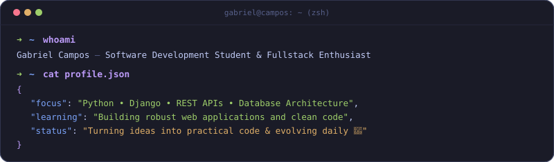
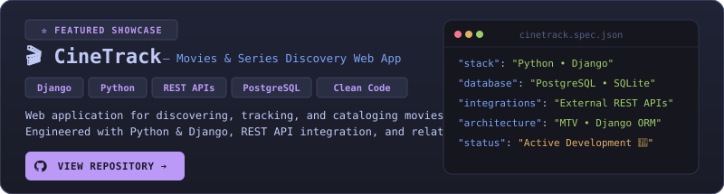

<!-- ╔══════════════════════════════════════════════════════════════╗ -->
<!--                       GABRIEL CAMPOS                         -->
<!-- ╚══════════════════════════════════════════════════════════════╝ -->

 

 

---

## 👨‍💻 About Me

I am a Software Development student specializing in **Fullstack development** with a strong focus on **Python & Django**.

Currently expanding my expertise in web architecture, RESTful API design, relational databases, and clean code best practices. Passionate about transforming architectural knowledge into real-world, high-impact applications. 🚀

 

  

---

## 🎯 Current Focus

* 🐍 **Python & Django Ecosystem:** Deepening architecture patterns, MTV design, and ORM optimizations
* 🔌 **RESTful APIs:** Designing, consuming, and securing robust web services
* 🗄️ **Data Persistence:** Relational database modeling with PostgreSQL and SQLite
* 💻 **Modern Frontend:** Enhancing interactive client-side interfaces with TypeScript
* 🔧 **Engineering Practices:** Git workflows, clean architecture, and automated CI/CD pipelines

---

## ⚡ Tech Stack & Tooling

 

**🐍 Backend & Databases**

  

 

**💻 Frontend & Core**

  

 

**🛠️ DevOps & Development Environment**

  

---

  

  

---

## ⚡ Recent GitHub Activity

<!-- RECENT_ACTIVITY:START -->
- ⭐ Starred [`SnailSploit/Claude-Red`](https://github.com/SnailSploit/Claude-Red)
- 🔨 Pushed code to `main` in [`iGabrielCampos/projeto-integrador-frontend-Gabriel`](https://github.com/iGabrielCampos/projeto-integrador-frontend-Gabriel)
- 🔨 Pushed code to `main` in [`emanoelmaxiensc7m-creator/projeto-integrador-frontend-emanoel-max-`](https://github.com/emanoelmaxiensc7m-creator/projeto-integrador-frontend-emanoel-max-)
- 🔨 Pushed code to `feature/js-logica` in [`iGabrielCampos/projeto-integrador-frontend-Gabriel`](https://github.com/iGabrielCampos/projeto-integrador-frontend-Gabriel)
- 🌱 Created branch `feature/js-logica` in [`iGabrielCampos/projeto-integrador-frontend-Gabriel`](https://github.com/iGabrielCampos/projeto-integrador-frontend-Gabriel)
<!-- RECENT_ACTIVITY:END -->

---

## 📊 GitHub Analytics

 

&nbsp;

---

## 🐍 Contribution Graph

 

<picture>
  <source media="(prefers-color-scheme: dark)" srcset="https://raw.githubusercontent.com/iGabrielCampos/iGabrielCampos/output/github-snake-dark.svg">
  <source media="(prefers-color-scheme: light)" srcset="https://raw.githubusercontent.com/iGabrielCampos/iGabrielCampos/output/github-snake.svg">
  
</picture>

---

## 📫 Connect With Me

 

&nbsp;

&nbsp;

  

Feel free to reach out, connect, or explore my repositories!

 

 

<b>💡 "Always learning, always evolving." 🚀</b>

